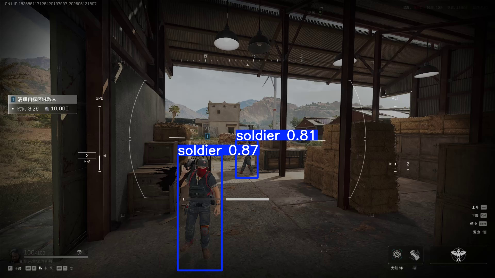
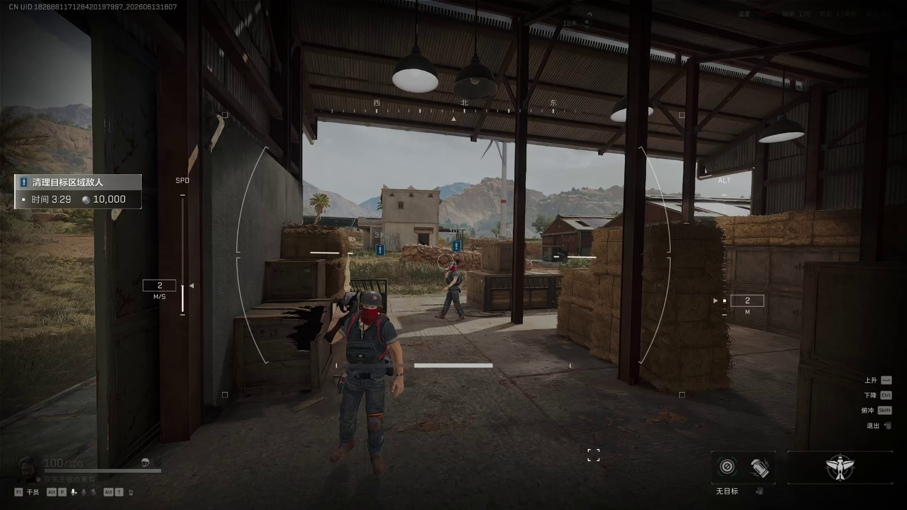
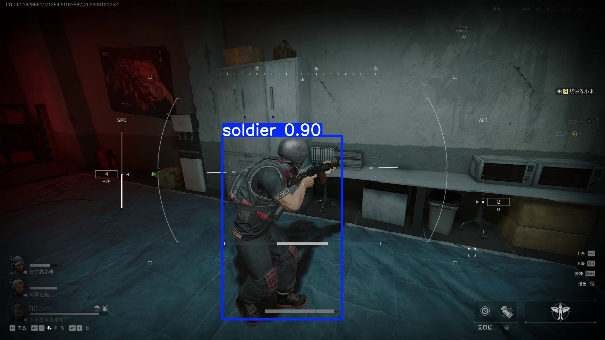
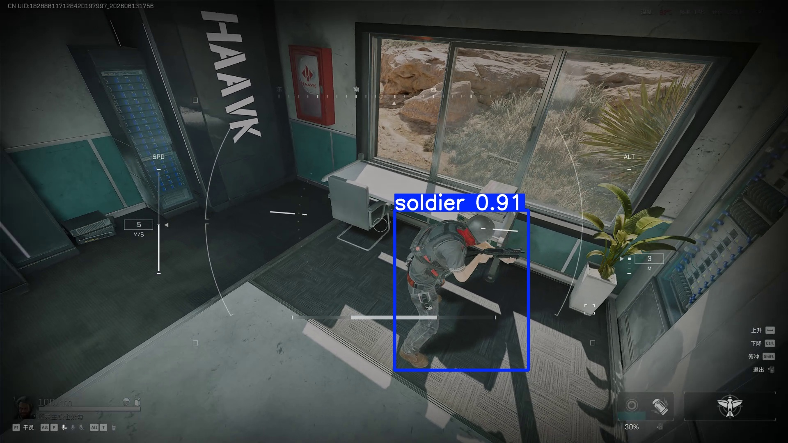

# YOLO Enemy Detection

基于 **YOLOv8** 的游戏人物目标检测工具，支持图片、视频和实时视频源，提供从视频抽帧到训练、验证与推理的完整命令行流程。

**Python 3.10+ · YOLOv8n · CPU / CUDA · 内置约 6 MB 模型**

## 检测效果

以下配图由仓库内置模型对《三角洲行动》游戏画面实际推理生成，参数为 `conf=0.25`、`iou=0.7`、`imgsz=640`，使用 CPU 执行。蓝框标出检测到的人物，数字表示该目标的模型置信度。这些样例展示检测输出，不作为独立测试集的精度评估。

### 室外多目标

同一画面中的两个目标分别输出检测框与置信度。



<details>
<summary>查看同一画面的原图</summary>



</details>

### 更多场景

| 室内近距离 | 俯视角度 |
| --- | --- |
|  |  |
| 人物轮廓与目标位置 | 视角变化下的检测输出 |

当前模型识别单一的 `soldier` 类人物目标，使用《三角洲行动》画面训练，**尚不具备敌我阵营区分能力**。

## 功能

| 功能 | 命令 | 输出 |
| --- | --- | --- |
| 视频抽帧 | `extract` | 按时间段与采样率导出图片 |
| 数据集构建 | `prepare` | 校验 YOLO 标注，划分训练集与验证集 |
| 模型训练 | `train` | 微调模型并保存最佳权重 |
| 模型验证 | `validate` | 在标注数据集上计算评估指标 |
| 目标检测 | `predict` | 标注画面、YOLO 预测标签与检测框 CSV |

推理以流式方式逐帧处理视频，避免一次性保留全部帧的预测结果。运行输出使用独立编号目录，重复执行时保留已有结果。

## 快速开始

### 1. 安装

推荐 Python 3.10 或更新版本。在项目根目录执行：

```powershell
git clone https://github.com/Corden404/YOLO-Enemy-Detection.git
cd YOLO-Enemy-Detection
conda activate dev
python -m pip install --index-url https://pypi.tuna.tsinghua.edu.cn/simple -e .
enemy-detect --help
```

上述命令使用已有的 Conda `dev` 环境；也可在自己的 Python 虚拟环境中执行安装。项目默认使用 CPU，CUDA 推理需要安装与本机驱动兼容的 PyTorch。

### 2. 检测图片或视频

把待检测素材放入本地 `data/` 目录，直接使用内置模型：

```powershell
enemy-detect predict --source "data/image.jpg"
enemy-detect predict --source "data/gameplay.mp4"
```

按需要调整置信度、使用 GPU 或加载自己的权重：

```powershell
enemy-detect predict --source "data/screenshots" --conf 0.6 --device 0
enemy-detect predict --source "data/image.jpg" --weights "runs/train/enemies/weights/best.pt"
```

也可通过 `python -m yolo_enemy_detection` 使用同一入口。摄像头使用 `--source 0`，视频流使用相应 URL。

### 3. 查看结果

默认输出写入 `runs/predict/enemies/`，包含：

- 带检测框和置信度的图片或视频。
- `labels/` 下的 YOLO 格式预测标签。
- `detections.csv`，记录每个检测框的帧序号、类别、置信度和像素坐标。

CSV 的 `frame_index` 表示本次推理中处理帧的顺序，`x1, y1, x2, y2` 表示左上角与右下角坐标，`image_width, image_height` 给出画面尺寸。

通过 `--output` 和 `--name` 自定义结果目录；使用 `--no-save-images` 可仅保留标签与 CSV。

```powershell
enemy-detect predict --source "data/gameplay.mp4" --output "runs/predict" --name gameplay --no-save-images
```

## 训练自己的模型

### 视频抽帧

从多个视频中提取训练素材。时间支持秒、`MM:SS` 和 `HH:MM:SS`；结束点不包含在时间区间内。省略 `--segment` 时处理整个视频。

```powershell
enemy-detect extract --source "data/video1.mp4" --output "data/frames" --fps 2 --segment 00:07-00:20 --segment 01:18-01:26
enemy-detect extract --source "data/video2.mp4" --output "data/frames" --fps 2
```

抽帧文件名包含来源视频、片段编号、时间戳与帧编号。再次运行会跳过已存在的图片。

### 标注与数据集构建

对图片完成 YOLO 格式标注，再构建数据集：

```powershell
enemy-detect prepare --frames "data/frames" --labels "data/labels.zip" --output "data/dataset" --classes soldier
```

标注支持 ZIP 或目录，标签文件主体名必须与图片一致。每行采用：

```text
class_id x_center y_center width height
```

坐标归一化到 `[0, 1]`，类别编号从 `0` 开始。背景图片使用空标签文件；只有明确传入 `--allow-missing-labels` 才会把缺少标签的图片当作背景。命令会校验重复文件名、缺失或多余标签、类别编号和坐标范围。

默认按来源视频划分训练与验证集，避免同一视频的相邻帧同时出现在两个集合中，需要至少两个来源视频。普通独立图片可使用 `--split-by image`。比例通过 `--train-ratio` 设置，随机种子通过 `--seed` 设置。构建命令拒绝覆盖已有数据集。

### 训练与验证

```powershell
enemy-detect train --data "data/dataset/dataset.yaml" --epochs 50 --batch 8 --device 0
enemy-detect validate --data "data/dataset/dataset.yaml" --weights "runs/train/enemies/weights/best.pt" --device 0
```

首次训练默认加载 `yolov8n.pt`，若本地没有该文件，Ultralytics 会下载初始权重。可使用 `--weights` 指定本地模型。训练结果写入 `runs/train/`；数据集配置由构建命令生成，路径与当前执行目录无关。

## 项目结构

```text
YOLO-Enemy-Detection/
├── assets/readme/                # 检测效果配图
├── src/yolo_enemy_detection/
│   ├── cli.py                    # 命令行入口
│   ├── frames.py                 # 视频抽帧
│   ├── dataset.py                # 标注校验与数据集构建
│   ├── engine.py                 # 训练、验证与推理
│   └── weights/enemy_yolov8n.pt  # 内置检测模型
├── tests/                        # 数据与抽帧测试
├── .github/workflows/ci.yml       # 自动测试
└── pyproject.toml                # 安装配置与依赖
```

视频、完整数据集、缓存和运行输出保留在本地，不纳入 Git。

## 开发与测试

```powershell
$env:PYTHONPATH = "src"
New-Item -ItemType Directory -Force .trash | Out-Null
python -m unittest discover -s tests -v
```

测试覆盖标注校验、背景图片处理、重复文件拒绝、按视频划分、防止覆盖已有数据集，以及非整数采样率下的抽帧行为。GitHub Actions 会在推送和 Pull Request 时运行这些测试。

## 参考

模型运行接口参见 [Ultralytics 推理文档](https://docs.ultralytics.com/modes/predict/)，数据格式参见 [目标检测数据格式](https://docs.ultralytics.com/datasets/detect/)。
